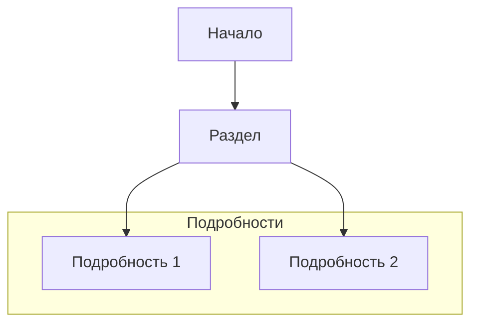
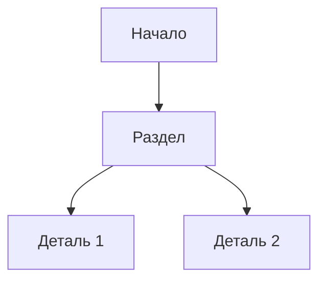
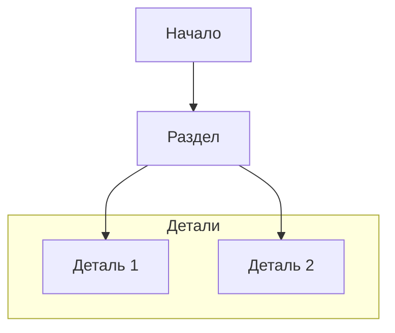

## 1
mermaid. Можно ли на githib pages так задать mermaid, чтобы узлы графа были кликабельные и разворачивались при нажатии на узел

Да — на GitHub Pages это можно сделать, но **не чисто средствами Mermaid**: Mermaid умеет вешать `click`-обработчик на узел, а уже ваш JavaScript должен перерисовывать или скрывать/показывать часть графа. Для «сворачивания» удобно использовать **collapsible subgraphs** (Mermaid 11.17+) либо собственный callback, который переключает состояние. [mermaid](https://mermaid.ai/open-source/syntax/flowchart.html)

## Самый простой вариант

В Mermaid 11.17+ subgraph можно изначально отобразить свернутым:



При `view: collapsed` внутренние узлы скрыты, а subgraph показан как один компактный узел с его заголовком. [mermaid](https://mermaid.ai/open-source/syntax/flowchart.html)

Но это **начальное состояние**, а не автоматическое «нажал — развернул, нажал — свернул». Для интерактивного toggle нужна небольшая обвязка на странице.

## Клик по узлу + JS

Mermaid поддерживает привязку клика к узлу через `click nodeId callback`; callback получает id узла. [mermaid](https://mermaid.ai/open-source/syntax/flowchart.html)

```html
<div id="graph"></div>

<script type="module">
  import mermaid from "https://cdn.jsdelivr.net/npm/mermaid@11/dist/mermaid.esm.min.mjs";

  mermaid.initialize({ startOnLoad: false, securityLevel: "loose" });

  window.toggleBranch = function (nodeId) {
    const graph = document.querySelector("#graph svg");
    if (!graph) return;

    // Скрываем/показываем узлы ветки по их id.
    ["C", "D"].forEach((id) => {
      const node = graph.querySelector(`#flowchart-${id}`);
      if (node) {
        node.style.display = node.style.display === "none" ? "" : "none";
      }
    });
  };

  const definition = `
flowchart TD
  A[Начало] --> B[Раздел]
  B --> C[Подробность 1]
  B --> D[Подробность 2]

  click B call toggleBranch()
`;

  const { svg } = await mermaid.render("graph", definition);
  document.getElementById("graph").innerHTML = svg;
</script>
```

Важно: `securityLevel: "loose"` нужен, чтобы Mermaid разрешил click-callback; по умолчанию в strict-режиме интерактивность ограничена. [emersonbottero.github](https://emersonbottero.github.io/mermaid-docs/config/usage.html)

## Надежнее: перерисовка графа

Скрытие SVG-элементов работает, но связи и раскладка могут выглядеть неидеально. Более предсказуемый подход — хранить две версии Mermaid-кода и перерисовывать диаграмму при клике:

```js
const collapsed = `
flowchart TD
  A[Начало] --> B[Раздел]
  click B call toggleBranch()
`;

const expanded = `
flowchart TD
  A[Начало] --> B[Раздел]
  B --> C[Подробность 1]
  B --> D[Подробность 2]
  click B call toggleBranch()
`;

let isExpanded = false;

window.toggleBranch = async function () {
  isExpanded = !isExpanded;
  const { svg } = await mermaid.render("graph", isExpanded ? expanded : collapsed);
  document.getElementById("graph").innerHTML = svg;
};
```

Это даст эффект «узел раскрылся/свернулся», хотя Mermaid не делает плавную анимацию раскрытия из коробки. Такой подход с toggling `display` также предлагался как рабочее решение для expand/collapse в Mermaid. [github](https://github.com/mermaid-js/mermaid/issues/2461)

## Что выбрать

| Задача | Подход |
|---|---|
| Просто показать свернутый блок при загрузке | `subgraph ... end` + `@{ view: collapsed }`  [mermaid](https://mermaid.ai/open-source/syntax/flowchart.html) |
| Клик по узлу раскрывает/скрывает ветку | `click ... call ...` + JavaScript |
| Аккуратная перестройка связей | Перерисовка Mermaid-диаграммы из двух определений |
| Клик открывает внешнюю страницу | `click nodeId href "https://..."`  [mermaid](https://mermaid.ai/open-source/syntax/flowchart.html) |

Для GitHub Pages ограничений нет: это обычный статический сайт, поэтому можно подключить Mermaid через CDN и добавить собственный `script.js`. Если используете Jekyll/GitHub Pages с Markdown, лучше вынести JS в отдельный файл, а не вставлять сложный `<script>` прямо в Markdown.

## 1.1

Да, **самый простой и практичный вариант — не парсить/переписывать Markdown, а открыть `test.md` через маленький HTML-просмотрщик**, который рендерит Markdown, находит блоки ```mermaid и подключает Mermaid + JS. JavaScript на GitHub Pages нужен обязательно: интерактивное раскрытие/сворачивание — это событие в браузере, статический Markdown сам по себе его не выполняет.  [mermaid](https://mermaid.ai/open-source/config/usage.html)

## Сравнение вариантов

| Вариант | Что делаете | Нужен JS | Сложность | Клик по узлу | Разворачивание/сворачивание | Когда выбирать |
|---|---|---:|---:|---|---|---|
| **A. Один `viewer.html` + ваш `test.md`** | Кладете `viewer.html`, он читает `test.md`, рендерит Mermaid и обрабатывает клики | Да | **Минимальная** | Да | Да | **Лучший старт** |
| **B. Препроцессор MD → HTML** | Скрипт/действие превращает `test.md` в `test.html` с готовым JS | Да | Средняя | Да | Да | Если нужен чистый статический HTML без рантайм-загрузки MD |
| **C. Mermaid collapsible subgraphs** | В `test.md` используете `@{ view: collapsed }` | Нет для начального состояния | Низкая | Не обязательно | Только стартовое свертывание | Если достаточно «по умолчанию свернуто» |
| **D. Готовая библиотека interactive-mermaid** | Подключаете библиотеку и её `onNodeClick` | Да | Низкая/средняя | Да | Зависит от вашей логики | Если нужны шаги, подсветка, инспекция узлов |
| **E. Полноценный SPA / React / Vue** | Создаете приложение с состоянием графа | Да | Высокая | Да | Да, наиболее гибко | Для большого интерактивного приложения |

Mermaid поддерживает `click nodeId call myFunction()` только при `securityLevel: "loose"`; в стандартном strict-режиме callback игнорируется.  [mermaid](https://mermaid.ai/open-source/config/usage.html) Нативного штатного «клик по узлу → развернуть/свернуть подграф» в Mermaid пока нет: это открытая feature request.  [mermaid](https://mermaid.ai/open-source/syntax/flowchart.html)

## Рекомендую: вариант A

Структура в репозитории:

```text
mermaid/ver1/test1/
├── index.html
├── viewer.js
└── test.md
```

GitHub Pages открываете как:

```text
https://bpmbpm.github.io/graph/mermaid/ver1/test1/
```

В `test.md` оставляете **обычный** Mermaid-блок:

````md
# Тестовый граф


````

В `index.html` — минимальный просмотрщик:

```html
<!doctype html>
<html lang="ru">
<head>
  <meta charset="utf-8">
  <title>Interactive Mermaid</title>
  <script type="module" src="./viewer.js"></script>
  <style>
    body { font-family: system-ui, sans-serif; margin: 24px; }
    #graph svg { max-width: 100%; height: auto; }
  </style>
</head>
<body>
  <div id="content"></div>
</body>
</html>
```

В `viewer.js`:

```js
import mermaid from "https://cdn.jsdelivr.net/npm/mermaid@11/dist/mermaid.esm.min.mjs";
import { marked } from "https://cdn.jsdelivr.net/npm/marked/marked.min.js";

mermaid.initialize({
  startOnLoad: false,
  securityLevel: "loose"
});

window.toggleNode = function () {
  const svg = document.querySelector("#content svg");
  if (!svg) return;

  ["C", "D"].forEach((id) => {
    const node = svg.querySelector(`g[data-id="${id}"], #flowchart-${id}`);
    if (node) {
      node.style.display = node.style.display === "none" ? "" : "none";
    }
  });
};

const response = await fetch("./test.md");
const markdown = await response.text();

const html = marked.parse(markdown);
const container = document.getElementById("content");
container.innerHTML = html;

await mermaid.run({
  querySelector: "#content .mermaid, #content pre code.language-mermaid"
});
```

Это самый короткий путь: вы продолжаете редактировать `test.md`, а `index.html` просто является «интерактивной оберткой». `securityLevel: "loose"` обязателен для click-callback.  [mermaid](https://mermaid.ai/open-source/config/usage.html)

## Вариант B: препроцессор

Если хотите, чтобы по ссылке открывался уже готовый `test.html`, добавьте маленький Node-скрипт, например `build.mjs`, который:

1. Читает `test.md`.
2. Находит блоки ```` ```mermaid ````.
3. Вставляет их в HTML-шаблон вместе с Mermaid и вашим JS.
4. Создает `test.html`.

```bash
node build.mjs
git add test.html
git commit -m "Build interactive Mermaid page"
git push
```

Плюс: страница не зависит от `fetch("./test.md")` и работает максимально просто как статический файл. Минус: после каждого изменения `.md` нужно перезапускать сборку (или настроить GitHub Actions).

## Вариант C: collapsible subgraph

Если «развернуть» означает лишь показать заранее скрытую группу узлов при первой загрузке, это можно сделать без JS:

````md

````

`@{ view: collapsed }` сворачивает subgraph в компактный узел; эта возможность появилась в Mermaid 11.17.0.  Но это **не toggle по клику**: чтобы пользователь мог сам раскрывать и сворачивать, все равно потребуется JS.

## Важные ограничения

- Без JavaScript нельзя сделать настоящее переключение состояния в браузере: GitHub Pages отдает статические файлы, а клик должен обрабатываться клиентским кодом. [mermaid](https://mermaid.ai/open-source/config/usage.html)
- Не используйте `securityLevel: "loose"` для диаграмм, которые могут редактировать недоверенные пользователи: этот режим разрешает HTML в подписях и click-функциональность. [mermaid](https://mermaid.ai/open-source/config/usage.html)
- Для вашего случая я бы начал с **варианта A**: один `index.html`, один `viewer.js`, а `test.md` остается источником графа. Позже, если потребуется, добавите `build.mjs` или GitHub Action для варианта B.
  
