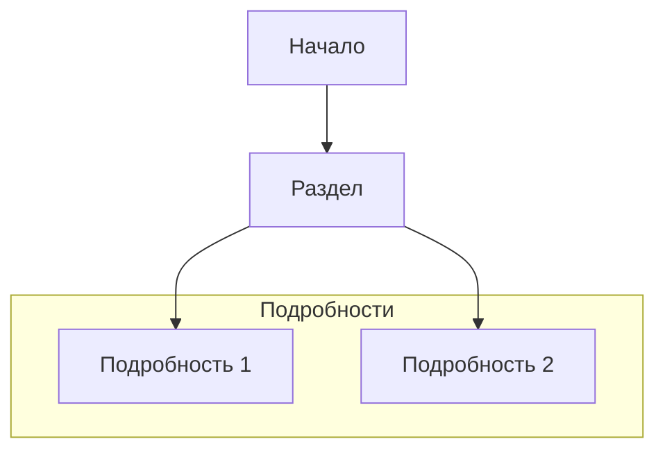

## 1

Да — на GitHub Pages это можно сделать, но **не чисто средствами Mermaid**: Mermaid умеет вешать `click`-обработчик на узел, а уже ваш JavaScript должен перерисовывать или скрывать/показывать часть графа. Для «сворачивания» удобно использовать **collapsible subgraphs** (Mermaid 11.17+) либо собственный callback, который переключает состояние. [mermaid](https://mermaid.ai/open-source/syntax/flowchart.html)

## Самый простой вариант

В Mermaid 11.17+ subgraph можно изначально отобразить свернутым:



При `view: collapsed` внутренние узлы скрыты, а subgraph показан как один компактный узел с его заголовком. [mermaid](https://mermaid.ai/open-source/syntax/flowchart.html)

Но это **начальное состояние**, а не автоматическое «нажал — развернул, нажал — свернул». Для интерактивного toggle нужна небольшая обвязка на странице.

## Клик по узлу + JS

Mermaid поддерживает привязку клика к узлу через `click nodeId callback`; callback получает id узла. [mermaid](https://mermaid.ai/open-source/syntax/flowchart.html)

```html
<div id="graph"></div>

<script type="module">
  import mermaid from "https://cdn.jsdelivr.net/npm/mermaid@11/dist/mermaid.esm.min.mjs";

  mermaid.initialize({ startOnLoad: false, securityLevel: "loose" });

  window.toggleBranch = function (nodeId) {
    const graph = document.querySelector("#graph svg");
    if (!graph) return;

    // Скрываем/показываем узлы ветки по их id.
    ["C", "D"].forEach((id) => {
      const node = graph.querySelector(`#flowchart-${id}`);
      if (node) {
        node.style.display = node.style.display === "none" ? "" : "none";
      }
    });
  };

  const definition = `
flowchart TD
  A[Начало] --> B[Раздел]
  B --> C[Подробность 1]
  B --> D[Подробность 2]

  click B call toggleBranch()
`;

  const { svg } = await mermaid.render("graph", definition);
  document.getElementById("graph").innerHTML = svg;
</script>
```

Важно: `securityLevel: "loose"` нужен, чтобы Mermaid разрешил click-callback; по умолчанию в strict-режиме интерактивность ограничена. [emersonbottero.github](https://emersonbottero.github.io/mermaid-docs/config/usage.html)

## Надежнее: перерисовка графа

Скрытие SVG-элементов работает, но связи и раскладка могут выглядеть неидеально. Более предсказуемый подход — хранить две версии Mermaid-кода и перерисовывать диаграмму при клике:

```js
const collapsed = `
flowchart TD
  A[Начало] --> B[Раздел]
  click B call toggleBranch()
`;

const expanded = `
flowchart TD
  A[Начало] --> B[Раздел]
  B --> C[Подробность 1]
  B --> D[Подробность 2]
  click B call toggleBranch()
`;

let isExpanded = false;

window.toggleBranch = async function () {
  isExpanded = !isExpanded;
  const { svg } = await mermaid.render("graph", isExpanded ? expanded : collapsed);
  document.getElementById("graph").innerHTML = svg;
};
```

Это даст эффект «узел раскрылся/свернулся», хотя Mermaid не делает плавную анимацию раскрытия из коробки. Такой подход с toggling `display` также предлагался как рабочее решение для expand/collapse в Mermaid. [github](https://github.com/mermaid-js/mermaid/issues/2461)

## Что выбрать

| Задача | Подход |
|---|---|
| Просто показать свернутый блок при загрузке | `subgraph ... end` + `@{ view: collapsed }`  [mermaid](https://mermaid.ai/open-source/syntax/flowchart.html) |
| Клик по узлу раскрывает/скрывает ветку | `click ... call ...` + JavaScript |
| Аккуратная перестройка связей | Перерисовка Mermaid-диаграммы из двух определений |
| Клик открывает внешнюю страницу | `click nodeId href "https://..."`  [mermaid](https://mermaid.ai/open-source/syntax/flowchart.html) |

Для GitHub Pages ограничений нет: это обычный статический сайт, поэтому можно подключить Mermaid через CDN и добавить собственный `script.js`. Если используете Jekyll/GitHub Pages с Markdown, лучше вынести JS в отдельный файл, а не вставлять сложный `<script>` прямо в Markdown.
