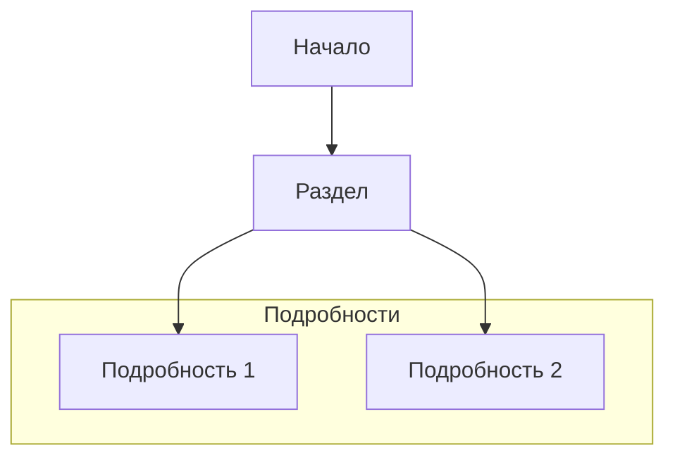
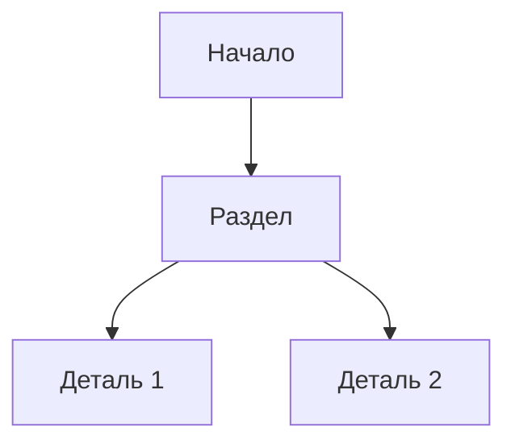
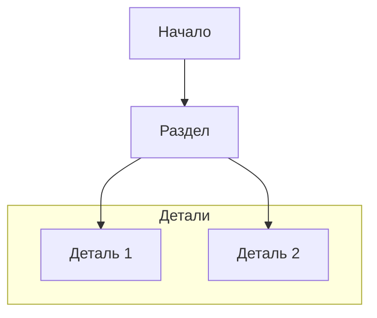
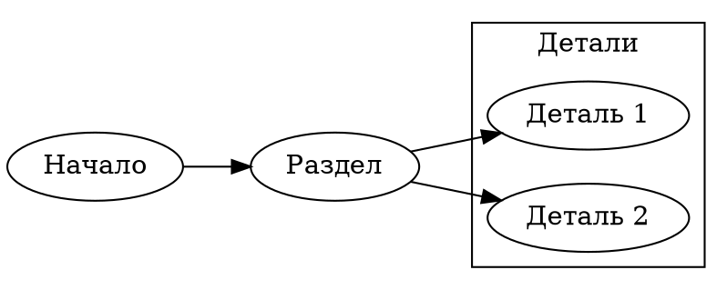

## 1
mermaid. Можно ли на githib pages так задать mermaid, чтобы узлы графа были кликабельные и разворачивались при нажатии на узел

Да — на GitHub Pages это можно сделать, но **не чисто средствами Mermaid**: Mermaid умеет вешать `click`-обработчик на узел, а уже ваш JavaScript должен перерисовывать или скрывать/показывать часть графа. Для «сворачивания» удобно использовать **collapsible subgraphs** (Mermaid 11.17+) либо собственный callback, который переключает состояние. [mermaid](https://mermaid.ai/open-source/syntax/flowchart.html)

## Самый простой вариант

В Mermaid 11.17+ subgraph можно изначально отобразить свернутым:



При `view: collapsed` внутренние узлы скрыты, а subgraph показан как один компактный узел с его заголовком. [mermaid](https://mermaid.ai/open-source/syntax/flowchart.html)

Но это **начальное состояние**, а не автоматическое «нажал — развернул, нажал — свернул». Для интерактивного toggle нужна небольшая обвязка на странице.

## Клик по узлу + JS

Mermaid поддерживает привязку клика к узлу через `click nodeId callback`; callback получает id узла. [mermaid](https://mermaid.ai/open-source/syntax/flowchart.html)

```html
<div id="graph"></div>

<script type="module">
  import mermaid from "https://cdn.jsdelivr.net/npm/mermaid@11/dist/mermaid.esm.min.mjs";

  mermaid.initialize({ startOnLoad: false, securityLevel: "loose" });

  window.toggleBranch = function (nodeId) {
    const graph = document.querySelector("#graph svg");
    if (!graph) return;

    // Скрываем/показываем узлы ветки по их id.
    ["C", "D"].forEach((id) => {
      const node = graph.querySelector(`#flowchart-${id}`);
      if (node) {
        node.style.display = node.style.display === "none" ? "" : "none";
      }
    });
  };

  const definition = `
flowchart TD
  A[Начало] --> B[Раздел]
  B --> C[Подробность 1]
  B --> D[Подробность 2]

  click B call toggleBranch()
`;

  const { svg } = await mermaid.render("graph", definition);
  document.getElementById("graph").innerHTML = svg;
</script>
```

Важно: `securityLevel: "loose"` нужен, чтобы Mermaid разрешил click-callback; по умолчанию в strict-режиме интерактивность ограничена. [emersonbottero.github](https://emersonbottero.github.io/mermaid-docs/config/usage.html)

## Надежнее: перерисовка графа

Скрытие SVG-элементов работает, но связи и раскладка могут выглядеть неидеально. Более предсказуемый подход — хранить две версии Mermaid-кода и перерисовывать диаграмму при клике:

```js
const collapsed = `
flowchart TD
  A[Начало] --> B[Раздел]
  click B call toggleBranch()
`;

const expanded = `
flowchart TD
  A[Начало] --> B[Раздел]
  B --> C[Подробность 1]
  B --> D[Подробность 2]
  click B call toggleBranch()
`;

let isExpanded = false;

window.toggleBranch = async function () {
  isExpanded = !isExpanded;
  const { svg } = await mermaid.render("graph", isExpanded ? expanded : collapsed);
  document.getElementById("graph").innerHTML = svg;
};
```

Это даст эффект «узел раскрылся/свернулся», хотя Mermaid не делает плавную анимацию раскрытия из коробки. Такой подход с toggling `display` также предлагался как рабочее решение для expand/collapse в Mermaid. [github](https://github.com/mermaid-js/mermaid/issues/2461)

## Что выбрать

| Задача | Подход |
|---|---|
| Просто показать свернутый блок при загрузке | `subgraph ... end` + `@{ view: collapsed }`  [mermaid](https://mermaid.ai/open-source/syntax/flowchart.html) |
| Клик по узлу раскрывает/скрывает ветку | `click ... call ...` + JavaScript |
| Аккуратная перестройка связей | Перерисовка Mermaid-диаграммы из двух определений |
| Клик открывает внешнюю страницу | `click nodeId href "https://..."`  [mermaid](https://mermaid.ai/open-source/syntax/flowchart.html) |

Для GitHub Pages ограничений нет: это обычный статический сайт, поэтому можно подключить Mermaid через CDN и добавить собственный `script.js`. Если используете Jekyll/GitHub Pages с Markdown, лучше вынести JS в отдельный файл, а не вставлять сложный `<script>` прямо в Markdown.

## 1.1

Да, **самый простой и практичный вариант — не парсить/переписывать Markdown, а открыть `test.md` через маленький HTML-просмотрщик**, который рендерит Markdown, находит блоки ```mermaid и подключает Mermaid + JS. JavaScript на GitHub Pages нужен обязательно: интерактивное раскрытие/сворачивание — это событие в браузере, статический Markdown сам по себе его не выполняет.  [mermaid](https://mermaid.ai/open-source/config/usage.html)

## Сравнение вариантов

| Вариант | Что делаете | Нужен JS | Сложность | Клик по узлу | Разворачивание/сворачивание | Когда выбирать |
|---|---|---:|---:|---|---|---|
| **A. Один `viewer.html` + ваш `test.md`** | Кладете `viewer.html`, он читает `test.md`, рендерит Mermaid и обрабатывает клики | Да | **Минимальная** | Да | Да | **Лучший старт** |
| **B. Препроцессор MD → HTML** | Скрипт/действие превращает `test.md` в `test.html` с готовым JS | Да | Средняя | Да | Да | Если нужен чистый статический HTML без рантайм-загрузки MD |
| **C. Mermaid collapsible subgraphs** | В `test.md` используете `@{ view: collapsed }` | Нет для начального состояния | Низкая | Не обязательно | Только стартовое свертывание | Если достаточно «по умолчанию свернуто» |
| **D. Готовая библиотека interactive-mermaid** | Подключаете библиотеку и её `onNodeClick` | Да | Низкая/средняя | Да | Зависит от вашей логики | Если нужны шаги, подсветка, инспекция узлов |
| **E. Полноценный SPA / React / Vue** | Создаете приложение с состоянием графа | Да | Высокая | Да | Да, наиболее гибко | Для большого интерактивного приложения |

Mermaid поддерживает `click nodeId call myFunction()` только при `securityLevel: "loose"`; в стандартном strict-режиме callback игнорируется.  [mermaid](https://mermaid.ai/open-source/config/usage.html) Нативного штатного «клик по узлу → развернуть/свернуть подграф» в Mermaid пока нет: это открытая feature request.  [mermaid](https://mermaid.ai/open-source/syntax/flowchart.html)

## Рекомендую: вариант A

Структура в репозитории:

```text
mermaid/ver1/test1/
├── index.html
├── viewer.js
└── test.md
```

GitHub Pages открываете как:

```text
https://bpmbpm.github.io/graph/mermaid/ver1/test1/
```

В `test.md` оставляете **обычный** Mermaid-блок:

````md
# Тестовый граф


````

В `index.html` — минимальный просмотрщик:

```html
<!doctype html>
<html lang="ru">
<head>
  <meta charset="utf-8">
  <title>Interactive Mermaid</title>
  <script type="module" src="./viewer.js"></script>
  <style>
    body { font-family: system-ui, sans-serif; margin: 24px; }
    #graph svg { max-width: 100%; height: auto; }
  </style>
</head>
<body>
  <div id="content"></div>
</body>
</html>
```

В `viewer.js`:

```js
import mermaid from "https://cdn.jsdelivr.net/npm/mermaid@11/dist/mermaid.esm.min.mjs";
import { marked } from "https://cdn.jsdelivr.net/npm/marked/marked.min.js";

mermaid.initialize({
  startOnLoad: false,
  securityLevel: "loose"
});

window.toggleNode = function () {
  const svg = document.querySelector("#content svg");
  if (!svg) return;

  ["C", "D"].forEach((id) => {
    const node = svg.querySelector(`g[data-id="${id}"], #flowchart-${id}`);
    if (node) {
      node.style.display = node.style.display === "none" ? "" : "none";
    }
  });
};

const response = await fetch("./test.md");
const markdown = await response.text();

const html = marked.parse(markdown);
const container = document.getElementById("content");
container.innerHTML = html;

await mermaid.run({
  querySelector: "#content .mermaid, #content pre code.language-mermaid"
});
```

Это самый короткий путь: вы продолжаете редактировать `test.md`, а `index.html` просто является «интерактивной оберткой». `securityLevel: "loose"` обязателен для click-callback.  [mermaid](https://mermaid.ai/open-source/config/usage.html)

## Вариант B: препроцессор

Если хотите, чтобы по ссылке открывался уже готовый `test.html`, добавьте маленький Node-скрипт, например `build.mjs`, который:

1. Читает `test.md`.
2. Находит блоки ```` ```mermaid ````.
3. Вставляет их в HTML-шаблон вместе с Mermaid и вашим JS.
4. Создает `test.html`.

```bash
node build.mjs
git add test.html
git commit -m "Build interactive Mermaid page"
git push
```

Плюс: страница не зависит от `fetch("./test.md")` и работает максимально просто как статический файл. Минус: после каждого изменения `.md` нужно перезапускать сборку (или настроить GitHub Actions).

## Вариант C: collapsible subgraph

Если «развернуть» означает лишь показать заранее скрытую группу узлов при первой загрузке, это можно сделать без JS:

````md

````

`@{ view: collapsed }` сворачивает subgraph в компактный узел; эта возможность появилась в Mermaid 11.17.0.  Но это **не toggle по клику**: чтобы пользователь мог сам раскрывать и сворачивать, все равно потребуется JS.

## Важные ограничения

- Без JavaScript нельзя сделать настоящее переключение состояния в браузере: GitHub Pages отдает статические файлы, а клик должен обрабатываться клиентским кодом. [mermaid](https://mermaid.ai/open-source/config/usage.html)
- Не используйте `securityLevel: "loose"` для диаграмм, которые могут редактировать недоверенные пользователи: этот режим разрешает HTML в подписях и click-функциональность. [mermaid](https://mermaid.ai/open-source/config/usage.html)
- Для вашего случая я бы начал с **варианта A**: один `index.html`, один `viewer.js`, а `test.md` остается источником графа. Позже, если потребуется, добавите `build.mjs` или GitHub Action для варианта B.
  
## 1.2

Да. **Через браузерный JS можно**, но локальный `.md` нельзя просто открыть через `fetch("./test.md")` при запуске файла по `file://` — браузер блокирует такой доступ из-за политики origin/CORS. Вместо этого пользователь выбирает файл через `<input type="file">` или перетаскивает его в окно; тогда JS получает `File` и читает его через `FileReader` или `file.text()`. [developer.mozilla](https://developer.mozilla.org/en-US/docs/Web/API/FileReader)

## Варианты запуска

| Вариант | Как запускается | Нужен сервер | Нужен Node/build | Может читать `test.md` рядом с HTML | Удобство |
|---|---|---:|---:|---|---|
| **1. HTML + выбор файла** | Двойной клик по `index.html`, затем выбрать `test.md` | Нет | Нет | Да, после выбора пользователем | **Самый простой** |
| **2. HTML + drag & drop** | Перетащить `test.md` на открытую страницу | Нет | Нет | Да | Очень удобно |
| **3. HTML + `fetch()`** | Открыть `index.html` через GitHub Pages или локальный сервер | Для локального `fetch` — да | Нет | Да | Удобно онлайн, но не по `file://` |
| **4. Node-препроцессор `build.mjs`** | `node build.mjs`, затем открыть `test.html` | Нет | Да | Да, на этапе сборки | Хорош для публикации |
| **5. Electron / Tauri** | Отдельное desktop-приложение | Нет | Да | Да, с правами приложения | Для постоянного локального инструмента |

Для вашей задачи — «открыть `test.md`, увидеть интерактивный Mermaid» — я бы выбрал **вариант 2: drag & drop**. Он работает без сервера, без Node и без пересборки.

## Почему `fetch` не сработает локально

Когда вы открываете `index.html` двойным кликом, страница имеет origin `file://`. JavaScript обычно не может выполнить `fetch("./test.md")` к соседнему локальному файлу: браузеры ограничивают доступ к файловой системе; для серверных файлов `fetch` требует CORS-разрешение. [developer.mozilla](https://developer.mozilla.org/en-US/docs/Web/API/FileReader)

Однако когда пользователь сам выбирает файл в `<input type="file">` или бросает его на страницу, браузер предоставляет странице объект `File`; его содержимое можно прочитать в JS. [developer.mozilla](https://developer.mozilla.org/en-US/docs/Web/API/File_API)

## Самый простой вариант: drag & drop

Сделайте один файл `viewer.html` — без отдельных `viewer.js`, без сборки и без сервера:

```html
<!doctype html>
<html lang="ru">
<head>
<meta charset="utf-8">
<title>Interactive Mermaid Viewer</title>
<script src="https://cdn.jsdelivr.net/npm/mermaid@11/dist/mermaid.min.js"></script>
<script src="https://cdn.jsdelivr.net/npm/marked/marked.min.js"></script>
<style>
  body { font-family: system-ui, sans-serif; margin: 24px; }
  #drop {
    border: 2px dashed #888;
    padding: 40px;
    text-align: center;
    border-radius: 12px;
  }
  #graph svg { max-width: 100%; height: auto; }
</style>
</head>
<body>

<div id="drop">
  Перетащите сюда <b>test.md</b><br>
  или <input type="file" id="file" accept=".md,.markdown,.txt">
</div>

<div id="content"></div>

<script>
mermaid.initialize({
  startOnLoad: false,
  securityLevel: "loose"
});

// Функция вызывается из Mermaid:
// click B call toggleNode()
window.toggleNode = function (nodeId) {
  const svg = document.querySelector("#content svg");
  if (!svg) return;

  // Пример: узел B скрывает/показывает ветку C и D.
  ["C", "D"].forEach(function (id) {
    const node =
      svg.querySelector(`g[data-id="${id}"]`) ||
      svg.querySelector(`#${CSS.escape("flowchart-" + id)}`);

    if (node) {
      node.style.display =
        node.style.display === "none" ? "" : "none";
    }
  });
};

async function showMarkdown(text) {
  const container = document.getElementById("content");
  container.innerHTML = marked.parse(text);

  await mermaid.run({
    querySelector:
      "#content .mermaid, #content pre code.language-mermaid"
  });
}

document.getElementById("file")
  .addEventListener("change", async (event) => {
    const file = event.target.files[0];
    if (file) {
      showMarkdown(await file.text());
    }
  });

const drop = document.getElementById("drop");

drop.addEventListener("dragover", (event) => {
  event.preventDefault();
});

drop.addEventListener("drop", async (event) => {
  event.preventDefault();

  const file = event.dataTransfer.files[0];
  if (file) {
    showMarkdown(await file.text());
  }
});
</script>

</body>
</html>
```

Положите `viewer.html` и `test.md` в одну папку, откройте `viewer.html` двойным щелчком и перетащите `test.md` в пунктирную область. Никакого сервера, Node, `npm install` или `build.mjs` не требуется.

## Как задать expand/collapse в `test.md`

В `test.md` оставляете обычный блок:

````md
# Тестовый граф


````

Mermaid поддерживает `click nodeId call callback()`; callback получает id узла и должен быть определен на странице. Эта возможность включается при `securityLevel: "loose"` и отключена в `strict`. [mermaid.js](https://mermaid.js.org/syntax/flowchart.html)

Для более «настоящего» collapse лучше не прятать отдельные SVG-узлы, а держать две версии Mermaid-кода и перерисовывать диаграмму:

```js
const diagrams = {
  collapsed: `
flowchart TD
  A[Начало] --> B[Раздел]
  click B call toggleBranch()
`,
  expanded: `
flowchart TD
  A[Начало] --> B[Раздел]
  B --> C[Деталь 1]
  B --> D[Деталь 2]
  click B call toggleBranch()
`
};

let expanded = false;

window.toggleBranch = async function () {
  expanded = !expanded;

  const container = document.getElementById("content");
  const { svg } = await mermaid.render(
    "graph-" + Date.now(),
    expanded ? diagrams.expanded : diagrams.collapsed
  );

  container.querySelector(".mermaid, pre").outerHTML =
    `<div class="mermaid">${svg}</div>`;
};
```

Это надежнее по отображению связей, но требует, чтобы логика expand/collapse была описана в JS, а не только внутри Markdown.

## Desktop без сервера

- **Обычный браузер + drag & drop** — уже является desktop-режимом в широком смысле: вы запускаете `viewer.html` локально, без веб-сервера.
- **Electron** — полноценное настольное приложение на Chromium; может читать локальные файлы через Node/fs и открывать `test.md` напрямую.
- **Tauri** — более легковесная альтернатива Electron; также предназначена для локальных desktop-приложений с веб-интерфейсом.
- **VS Code / расширение** — можно сделать расширение, которое открывает `.md`, рендерит Mermaid и добавляет собственные кнопки/клики; это удобно, но заметно сложнее одного HTML-файла.

Для первого прототипа достаточно **одного `viewer.html` с drag & drop**. Когда формат взаимодействия устоится, его же можно превратить в Electron/Tauri-приложение или в Node-сборщик для GitHub Pages.

## 2
Может быть есть online сервисы, где работает интерактивный mermaid (или иной "диаграмма как код")? 

Да, есть. Но важно различать **интерактивное редактирование** (кликнул — изменил узел) и **интерактивное выполнение диаграммы** (кликнул — раскрыл/свернул ветку, открыл панель, перешел по состоянию). Для вашей задачи нужен именно второй тип; большинство онлайн-редакторов Mermaid дают первый, а не второй. [mermaid](https://mermaid.ai/docs/getting-started/create-first-diagram)

## Что искать

| Сервис / подход | Интерактивность | Раскрытие/сворачивание ветвей | Подходит для вашего `test.md` | Оценка |
|---|---|---|---|---|
| **Mermaid Live Editor** — mermaid.live | Просмотр, drag-and-drop, редактирование | Обычно нет как штатной функции | Частично: можно тестировать синтаксис | Для прототипа |
| **Mermaid Chart / Visual Editor** | Клик по узлу открывает меню редактирования; код и диаграмма синхронизированы | Нет полноценного runtime toggle | Нет: это редактор, а не интерактивный viewer | Для рисования |
| **Mermaid Studio** | Поддерживает collapsible subgraphs; в режиме редактирования есть expand/collapse | Да, но в редакторе, не обязательно как публикуемый web-viewer | Частично | Перспективен |
| **Собственный viewer на GitHub Pages** | Полностью настраиваемая логика JS | Да | Да | **Лучший вариант** |
| **D2 / Graphviz / PlantUML онлайн** | Зависит от сервиса; обычно рендер + экспорт | Как правило нет | Нет | Не рекомендую для этой задачи |

Mermaid Chart позволяет кликать узлы, но это открывает меню редактирования узла; это не механизм «кликнул — ветка развернулась/свернулась».  Mermaid Studio заявляет поддержку collapsible flowchart subgraphs и expand/collapse в preview/edit mode, что ближе к нужной функциональности. [mermaid](https://mermaid.ai/docs/getting-started/create-first-diagram)

## Короткий тест сервиса

Вставьте в сервис этот код:


Затем проверьте по чек-листу:

1. **Рендерится ли диаграмма** без ошибок?
2. **Свернут ли subgraph `details`** при первом показе?
3. **Можно ли кликнуть по узлу `B`?**
4. **Выполняется ли `toggleBranch()`**, а не просто открывается меню редактирования?
5. **Можно ли развернуть `details` и снова свернуть** без перезагрузки страницы?
6. **Сохраняются ли связи** после раскрытия: `B --> C`, `B --> D`?
7. **Можно ли вставить свой JS** или подключить внешний `viewer.js`?
8. **Можно ли открыть локальный `.md`** через drag & drop или выбор файла?
9. **Работает ли результат после публикации** на GitHub Pages, а не только внутри редактора?
10. **Есть ли экспорт** в автономный HTML/SVG с сохранением интерактивности?

## Как интерпретировать результат

- Если клик по `B` только выделяет узел или открывает свойства — сервис **не решает** вашу задачу.
- Если `details@{ view: collapsed }` работает, но повторный toggle недоступен — подходит только для статичного «изначально свернуто».
- Если можно добавить JS-callback и он вызывается — сервис потенциально подходит, но проверьте, разрешает ли он `securityLevel: "loose"`; без него `click ... call ...` не сработает. [mermaideditor](https://mermaideditor.lol/blog/mermaid-click-events-interactive-diagrams)
- Если сервис умеет только редактировать диаграмму, но не позволяет встроить собственную логику раскрытия — используйте его для проектирования, а публиковать интерактивную версию лучше через собственный `viewer.html` на GitHub Pages.

## Практический вывод

Для вашего сценария наиболее реалистична связка:

```text
test.md  →  ваш viewer.html / viewer.js  →  интерактивный Mermaid
```

Онлайн-сервисы Mermaid удобны, чтобы быстро проверить синтаксис и внешний вид, но полноценное «кликнул по узлу — развернул/свернул» надежнее делать в собственном viewer: там вы контролируете `securityLevel`, JS-callback и логику состояний. [mermaideditor](https://mermaideditor.lol/blog/mermaid-click-events-interactive-diagrams)

## 2.1
< полноценное «кликнул по узлу — развернул/свернул»

Да, такие сервисы есть, но именно под Mermaid готовых публичных онлайн-сервисов с «клик по обычному узлу → развернуть/свернуть его поддерево» практически нет. Наиболее близкие варианты — **Mermaid Studio** (collapse/expand subgraphs в редакторе) и **Interactive Graphviz Diagrams** (клик по кластеру сворачивает/разворачивает его); для вашего формата `test.md` наиболее жизнеспособна собственная страница-viewer. [mermaidstudio](https://mermaidstudio.dev/docs/diagram-types/flowchart/)

## Ближайшие сервисы

| Сервис | Что умеет | «Клик по узлу → toggle ветки» | Формат | Вердикт |
|---|---|---|---|---|
| **Mermaid Studio** | Mermaid-редактор; на Mermaid 11.17+ поддерживает сворачивание subgraph в один узел; в edit mode можно collapse/expand subgraphs; клик по элементу переходит к исходному коду | **Частично**: toggle есть для subgraph, но это редакторная функция, а не публикуемый интерактивный viewer | Mermaid | Лучший Mermaid-вариант, но не идеален |
| **Interactive Graphviz Diagrams** | DOT/CSV → интерактивный граф; клик по кластеру toggle expand/collapse, подсветка ребер, фильтрация; есть HTML-версия на Graphviz WASM | **Да**, для кластеров/подграфов | Graphviz DOT или CSV | **Наиболее близко к запросу**, но не Mermaid |
| **draw.io / diagrams.net** | Онлайн-редактор и desktop; поддерживает контейнеры с collapse/expand, импорт Mermaid | **Да**, для групп/контейнеров, но после импорта Mermaid это уже не «диаграмма как код» в исходном смысле | Собственный XML, импорт Mermaid | Хорош для ручной работы |
| **Mermaid Chart / Live Editor** | Редактирование, визуальный редактор, синхронизация кода и диаграммы | Нет полноценного runtime toggle | Mermaid | Не подходит |
| **Mermaidonline / AI mind map** | Заявляет drag, expand/collapse и редактирование mind map | Возможно для mind map, но не для произвольного Mermaid flowchart и не как универсальный viewer | Mind map / Mermaid | Проверять отдельно, но не основной кандидат |

Mermaid Studio поддерживает collapse/expand subgraphs: на Mermaid.js 11.17.0+ subgraph можно свернуть в один узел, а в режиме редактирования — развернуть обратно; также клик по элементу позволяет перейти к его исходной строке.  Однако это именно функции редактора, а не гарантированный публичный режим «открыл ссылку — кликаешь по узлам — диаграмма меняет структуру». [mermaidstudio](https://mermaidstudio.dev/docs/diagram-types/flowchart/)

## Самый близкий не-Mermaid вариант

**Interactive Graphviz Diagrams** выглядит наиболее близко к вашему требованию: у него заявлены клик по кластеру с toggle expand/collapse, перестроение ребер к свернутому узлу, collapse/expand вложенных кластеров и подсветка связей. [github](https://github.com/BartBrood/Interactive-Graphviz-Diagrams)

Тестовый DOT-пример:



Ожидаемое поведение: клик по `cluster_details` сворачивает `C` и `D` в компактный кластер; повторный клик разворачивает их. Это почти точно ваш сценарий, но исходник будет DOT/CSV, а не Mermaid. [github](https://github.com/BartBrood/Interactive-Graphviz-Diagrams)

## Практическая рекомендация

Если принципиален **Mermaid и `test.md`**, готового «нажал и всё работает» сервиса, по-видимому, нет. Лучший компромисс:

```text
test.md (Mermaid) → viewer.html + небольшой JS → интерактивные узлы
```

Если же важнее **готовое поведение без своего JS**, переходите на **Graphviz DOT + Interactive Graphviz Diagrams**: там collapse/expand по клику уже реализован. [github](https://github.com/BartBrood/Interactive-Graphviz-Diagrams)

Если нужен Mermaid, но приемлем редактор, попробуйте **Mermaid Studio**: создайте subgraph, сверните его, проверьте повторное раскрытие и выясните, можно ли опубликовать результат как standalone interactive page. [mermaidstudio](https://mermaidstudio.dev/docs/diagram-types/flowchart/)

